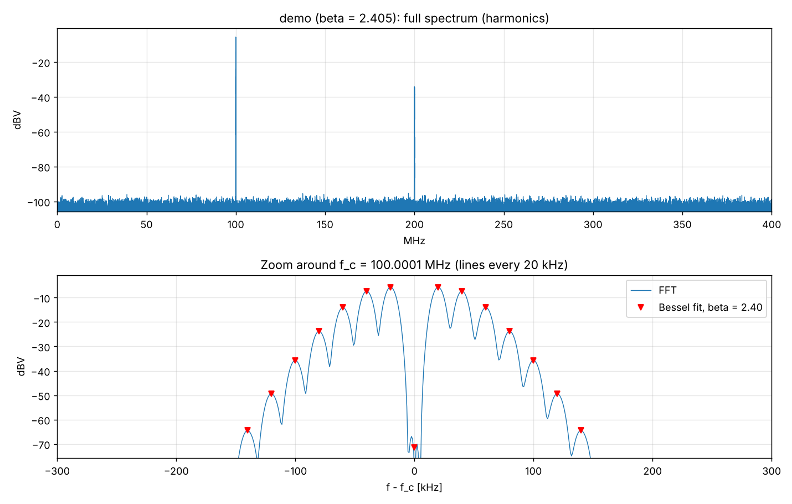

# FM Transmitter Workshop

An FM broadcast-band (88–108 MHz) transmitter built from discrete parts, taken all the way
from **simulation → breadboard → soldered PCB**. It was designed as a hands-on project for the
Electronics SIG of the IEEE Student Branch at the University of Patras, where student teams
build it over a semester.

Repository contents:
- the circuit and the reasoning behind each stage
- LTspice / ngspice simulations
- `fm_fft.py`, a script that **proves** the simulated output is FM by fitting the measured
  sidebands to Bessel functions
- a coil calculator for the hand-wound inductors
- the PCB, BOM and workshop slides

## The circuit


| Stage | What it does | Key idea |
|---|---|---|
| Colpitts VCO | Sets the carrier | f ≈ 1 / (2π√(LC)); the capacitive divider gives the feedback |
| Varactor modulator | Turns audio into frequency deviation | A reverse-biased junction is a voltage-controlled capacitor; the 1N4148 works as a cheap varactor |
| Buffer / PA | Isolates the oscillator and adds power | Load changes would otherwise pull the carrier frequency |
| L-match | Matches the PA to 50 Ω | Maximum power transfer into the filter and antenna |
| Low-pass filter | Removes the 2nd and 3rd harmonics | The PA is non-linear, so the harmonics have to be filtered |

All active parts are 2N3904 / 1N4148, so a whole kit costs about €25–30 per team.

## Simulation results (ngspice, LTspice device models)

VCO + modulator stage, 20 kHz test tone:

| Audio amplitude | f_c | Peak deviation | β |
|---|---|---|---|
| 0 V | 109.53 MHz | ±4.6 kHz (drift only) | – |
| 0.036 V | 109.52 MHz | ±47 kHz | ≈ 2.35 |
| 0.05 V | 109.51 MHz | ±67 kHz | ≈ 3.4 |
| 0.3 V | 109.38 MHz | ±290 kHz, **clipped** | – |

Modulation sensitivity is about **1.35 MHz/V**, so only tens of mV of audio are needed. Larger
amplitudes forward-bias the diode and clip. Retune the tank to move the carrier into the band.
LTspice puts the carrier about 0.5 MHz higher than ngspice for the same netlist.

## Proving it's FM: `fm_fft.py`

An FFT of a transmitter output alone doesn't show that the signal is FM: harmonics, AM or a
start-up transient can look similar. `fm_fft.py`:

1. reads the LTspice `.raw` and resamples it onto a uniform grid (LTspice uses variable time steps)
2. keeps only the steady state (default 60–260 µs, to drop oscillator start-up) and applies a Blackman window
3. fits the line amplitudes at f_c + k·f_m to |J_k(β)|, then prints f_c, β, the deviation, the Carson
   bandwidth and the delay T_d for a delay-line demodulator

Set the audio amplitude so that **β ≈ 2.405**: J₀ has its first zero there, so the carrier
disappears. A pure AM or harmonic artefact can't do that, so it is a clear visual proof of FM.



*`--demo` output: synthetic FM with β = 2.405. The fit returns β = 2.404, and the carrier
(k = 0) is about 61 dB below the first sidebands.*

```powershell
python -m venv .venv
.\.venv\Scripts\Activate.ps1          # if blocked: Set-ExecutionPolicy -Scope CurrentUser RemoteSigned
pip install -r requirements.txt

python analysis\fm_fft.py --demo                                   # no simulator needed
python analysis\fm_fft.py "sim\ltspice\fm_vco.raw" --node "V(vout)"
python analysis\fm_fft.py fm_vco.raw --node "v(vout)" --dialect ngspice
```

If LTspice deletes the `.raw` when it closes (Settings → Operation), run it headless:
`& "C:\Program Files\ADI\LTspice\LTspice.exe" -b fm_vco.asc`.

## Hand-wound coils: `coil_calc.py`

The tank and filter inductors are air-core coils wound on a drill bit. `coil_calc.py` uses
Wheeler's formula to compute the inductance and to find turns/length combinations for a target value:

```text
$ python tools/coil_calc.py --turns 6.5 --former 3.5 --wire 0.7
6.5 turns, 3.5 mm former, 0.7 mm wire, 4.55 mm long -> 113.9 nH
stretching the same coil:
  length  5.69 mm ->   96.8 nH
  ...
```

Stretching or squeezing the turns is the fine tuning, so treat the formula as a starting point
and do the final tuning on the bench.

## Build phases

1. **Simulate** – LTspice. Check the bias point, start-up, f_c and deviation, then run `fm_fft.py`.
2. **Breadboard** – check the bias with a multimeter. Find the carrier on an SDR or spectrum
   analyzer, then measure the filter with a NanoVNA.
3. **Solder** – the KiCad board, SMA output, measurements of harmonics and output power.

## Repository layout

```
analysis/fm_fft.py   FFT + Bessel-fit FM verification for .raw files
tools/coil_calc.py   air-core coil calculator (Wheeler)
sim/ltspice/         LTspice schematics
sim/ngspice/         ngspice netlists (second-simulator check)
hardware/kicad/      PCB
bom/                 bill of materials
docs/                figures, workshop slides
```

## A note on transmitting

Outside the very low power levels allowed for short-range devices (ERC/REC 70-03), radiating in
the FM broadcast band needs authorisation. This transmitter's PA can deliver far more than that. Run the transmitter into a 50 Ω dummy load or through an attenuator into the analyzer, and use
only a very short antenna for range tests.

## License

[MIT](LICENSE) © 2026 Vasileios Banakos. Built for the IEEE Student Branch, University of
Patras, Electronics SIG.
